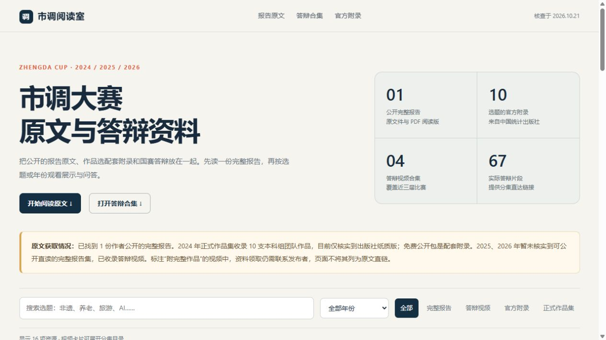

# 市调阅读室：2024—2026 原文与答辩资料

全国大学生市场调查与分析大赛公开资料的本地阅读页。

参考范围已与使用者确认：供 2027 届备赛，按答辩年份查找此前已结束的 2026、2025、2024 三届。

## 在线阅读

队友可直接访问 [市调阅读室](https://tangzy0121.github.io/market-survey-awards/)，无需 GitHub 登录。在线页面保留完整报告的 68 页翻页阅读、原文与附录下载，以及 67 段答辩视频直达链接。

本仓库及 Release 资料包均已公开。GitHub Actions 从固定版本的 Release 获取完整资源，核对 SHA-256 与文件清单后部署到 GitHub Pages；原文二进制文件保留在 Release 中，不写入 Git 历史。

## 下载完整阅读包

前往 [最新 Release](https://github.com/Tangzy0121/market-survey-awards/releases/latest)，下载 `market-survey-awards-2024-2026.zip`，解压后双击 `market-survey-awards/index.html`。

完整包保留原文文件和所有页面资源，无需安装依赖。报告与附录可以离线阅读，答辩视频需要联网。

## 已收录资料

| 内容 | 数量与说明 |
| --- | --- |
| 完整报告原文 | 1 份，2024 年同仁堂老字号转型项目；作者公开的 DOCX、68 页 PDF 阅读副本及逐页图像 |
| 官方附录 | 中国统计出版社公开的 2024 年作品选附录原始 ZIP，以及按 10 个选题整理的 DOCX |
| 答辩视频 | 2024—2026 年共 4 个合集，67 段实际答辩，包含分集直达链接 |
| 正式作品集 | 出版社书目及获取入口；整本免费电子版尚未核实 |

资料核查日期：2026 年 10 月 21 日。视频为第三方整理，部分页面可能要求登录 B 站。原报告的国三奖项依据作者自述，页面已标明，未建立独立的官方名单对应关系。

2026 年 10 月 22 日补充 [2025、2026 年原文获取线索](https://tangzy0121.github.io/market-survey-awards/#leads)：已打开分享目录、核对可见压缩包和领取说明，尚未取得并核实新增报告全文。网盘中的“2025正大杯国赛获奖作品信息.pdf”已预览为获奖公告，未计入完整报告。访问结果及原始网址记录于 [sources.json](output/sources.json) 的 `acquisition_leads`。

## 来源

- 完整报告及分析代码：[nofilo/TongRenTangRevival](https://github.com/nofilo/TongRenTangRevival)。
- 2024 年正式作品选：[中国统计出版社](https://www.zgtjcbs.com/tongjipujiduwu/5901)。
- 作品选官方附录：[出版社下载页](https://www.zgtjcbs.com/zaixianxiazailiebiao/5917)。
- 视频发布者、原始链接和分集目录：[sources.json](output/sources.json)。

保留原作者、出版社和视频发布者署名，未对第三方材料重新声明开源许可。

## 仓库与完整包

仓库保存 [HTML 阅读页](output/index.html)、来源清单、文档校验信息和页面预览。按工作区约定，PDF、DOCX、ZIP 和逐页图像放在 Release 下载包中，不写入 Git 历史。因此单独克隆仓库后，报告及附录需从完整包取得。

